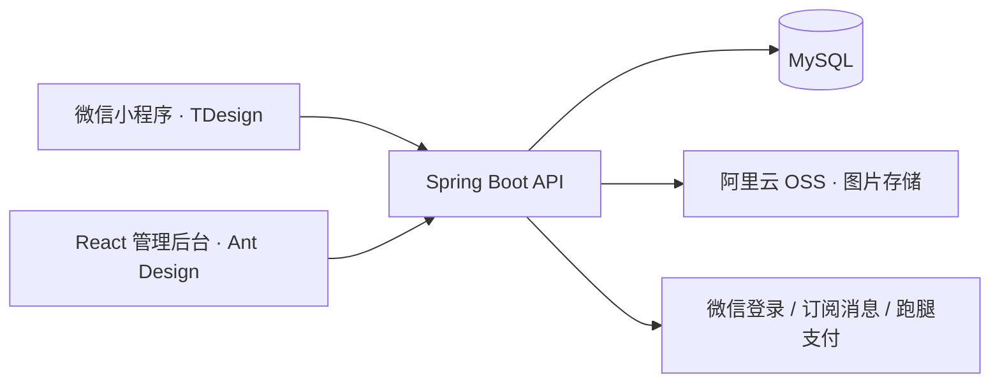

<div align="center">

# Campus Runner · 校园跑腿与二手交易

**让校园里的需求有人接，让闲置物品找到下一个主人。**

微信小程序 + React 管理后台 + Spring Boot API


[功能亮点](#功能亮点) · [技术架构](#技术架构) · [本地开发](#本地开发) · [项目文档](#项目文档) · [参与项目](#参与项目)

</div>

---

Campus Runner 是一套面向校园场景的全栈项目，将**跑腿代取、代买与校园二手交易**放在同一个微信小程序中，并提供配套的运营管理后台。

你可以从中了解一项校园服务如何从小程序页面，贯穿到身份认证、订单履约、图片管理和后台运营；也可以沿着二手商品发布、议价、私信和交付记录，阅读一条完整的业务实现。

Campus Runner is a full-stack campus services project for **campus errands and a second-hand marketplace**, built with WeChat Mini Program, React, Spring Boot and MySQL.

## 功能亮点

### 一个小程序，两类校园需求

| 模块 | 主要能力 |
| --- | --- |
| 校园跑腿 | 发布需求、分类与地址筛选、接单、取件、送达凭证、确认完成 |
| 代买服务 | 记录商品金额、提交购买凭证、结合跑腿报酬处理订单 |
| 二手市场 | 商品发布与编辑、分类检索、收藏、发布草稿恢复、个人商品管理 |
| 议价与沟通 | 提交和回复报价、议价记录、买卖双方私信、未读消息提示 |
| 二手履约 | 买家下单、卖家交付、买家确认、双方订单记录 |
| 个人中心 | 微信登录、个人资料、校园认证、地址簿和待办提醒 |

**交易方式：**二手模块采用 `OFFLINE` 线下交易模式，平台记录撮合与交付过程，新二手订单不发起线上支付、退款或卖家收款。跑腿模块包含微信支付、退款与接单人收款实现，使用时需自行配置并确认微信商户能力。

### 配套的运营管理后台

基于 React、TypeScript 和 Ant Design，覆盖跑腿订单、接单记录、用户与校园认证审核、二手商品与订单、议价与留言，以及学校地址、分类、轮播图和业务配置管理。

用户端与管理端共用 Spring Boot API，分别通过用户身份和管理员身份访问对应业务。

### 值得阅读的实现细节

- **订单地址快照**：下单时保存地址，后续修改或删除地址簿不改变历史订单的地址记录。[查看设计](docs/database/order-address-snapshot-migration.md)
- **创建请求幂等**：跑腿下单、商品发布和二手下单通过 `clientRequestId` 处理重复提交与结果恢复。[查看设计](docs/database/submission-idempotency.md)
- **统一图片资源管理**：按图片用途处理上传、归属、预览和业务绑定，覆盖头像、商品图片和履约凭证。[查看设计](docs/api/media-assets.md)
- **有业务约束的订单流转**：将接单、送达、确认完成以及支付、退款、收款状态分开处理。[查看流程](docs/mini-program/order-flow.md)
- **议价与会话记录**：包含报价有效性、商品变化后的报价失效、历史消息分页及增量读取。[查看实现说明](docs/api/second-hand.md)

## 技术架构



| 层级 | 技术选型 |
| --- | --- |
| 用户端 | 微信原生小程序、JavaScript、WXML / WXSS、TDesign MiniProgram |
| 管理端 | React 19、TypeScript、Vite 7、Ant Design、React Router、Axios |
| 服务端 | Java 21、Spring Boot 3.2.4、MyBatis、JWT |
| 数据与文件 | MySQL、阿里云 OSS |
| 外部能力 | 微信登录、订阅消息、微信支付及商家转账 |
| 接口文档 | OpenAPI 3、Knife4j |

### 仓库结构

```text
campus-runner/
├── apps/
│   ├── mini-program/       # 微信小程序：页面、组件、业务服务
│   ├── admin/              # React 管理后台
│   └── api/                # Spring Boot API 与部署脚本
├── docs/
│   ├── api/                # 接口与业务约束
│   ├── mini-program/       # 跑腿流程与小程序组件规范
│   ├── database/           # 数据库迁移及注意事项
│   └── deployment/         # 部署、检查与回滚
├── tests/                  # 小程序等专项逻辑检查
└── AGENTS.md               # 项目协作约束
```

服务端测试位于 `apps/api/src/test/`。

## 本地开发

### 1. 准备环境

- JDK 21；仓库提供 Maven Wrapper。
- Node.js：管理端 Vite 7 要求 `20.19+`（20.x）或 `22.12+`。
- MySQL、微信开发者工具。
- 自己的微信小程序、OSS 及所需微信支付配置。

```bash
git clone https://github.com/XXXHjf/campus-runner.git
cd campus-runner
```

> 当前仓库不提供完整的一键初始化数据库和可直接运行的后端示例配置。首次部署需要准备匹配当前代码的数据库结构及外部服务配置；不能仅执行一条启动命令就完成全部联调。

### 2. 配置并启动 API

先阅读[数据库变更导航](docs/database/README.md)。其中的 SQL 是分阶段迁移材料，不是完整初始化脚本，**不要按文件名排序全部执行**。

在 `apps/api/src/main/resources/application.yaml` 中准备自己的本地配置，主要包括：

| 配置项 | 对应位置 / 说明 |
| --- | --- |
| 数据库 | Spring 数据源配置，连接已准备好的 MySQL 数据库 |
| 登录凭证 | `com.mikasa.campus-runner.jwt`，配置签名密钥、有效期等 |
| 微信能力 | `com.mikasa.campus-runner.wechat`，配置小程序、订阅消息及支付参数 |
| 图片存储 | `com.mikasa.campus-runner.alioss`，配置 OSS 访问及存储参数 |
| HTTP 服务 | 本地可使用 `server.port=8080`、`server.ssl.enabled=false` |

配置字段以服务端的 [Properties 类](apps/api/src/main/java/com/mikasa/campusrunner/common/properties/)为准。微信支付配置会在启动时加载商户私钥并初始化证书管理器，因此即使只想浏览其他模块，也需要处理这些启动依赖。支付私钥通常放在 `apps/api/src/main/resources/apiclient_key.pem`，实际资源名由 `private-key-file-path` 配置。

配置完成后：

```bash
cd apps/api
./mvnw spring-boot:run
```

Windows PowerShell 使用 `./mvnw.cmd spring-boot:run`。本地 API 地址为 `http://localhost:8080`（使用上述端口时）。

`application.yaml` 与支付私钥已被 Git 忽略，但仍可能被 Maven 打入 JAR；打包前必须核对目标环境及资源内容。生产部署请按[服务器操作文档](docs/deployment/server-operations.md)执行，勿直接复用本地配置；生产数据库密码通过服务器权限为 `600` 的 `/root/campus-runner.env` 注入 `DB_PASSWORD`，不能写入 JAR。

### 3. 启动管理后台

在仓库根目录另开一个终端：

```bash
cd apps/admin
npm ci
npm run dev
```

访问终端输出的本地地址。默认情况下，Vite 将 `/api/` 和 `/admin/api/` 代理到 `http://localhost:8080`；需要其他 API 地址时可设置 `VITE_API_BASE_URL`。

管理端没有公开注册入口，需要在自己的环境中预先准备管理员账号。

### 4. 启动微信小程序

在仓库根目录另开一个终端：

```bash
cd apps/mini-program
npm ci
```

随后在微信开发者工具中：

1. 导入 `apps/mini-program`，使用自己的小程序 AppID。
2. 将 `app.js` 中的 `globalData.API_URL` 改为自己的 API 地址，避免连接原项目服务。
3. 执行「工具 → 构建 npm」，然后编译预览。
4. 真机及正式版本按微信要求配置合法域名、HTTPS 和相关消息模板。

开发者工具中的本地预览与真实支付、消息送达、真机交互需要分别验证。

## 项目文档

| 想了解什么 | 从这里开始 |
| --- | --- |
| 全部文档与阅读路径 | [文档导航](docs/README.md) |
| 用户登录与校园认证 | [用户注册与认证](docs/api/user-onboarding.md) |
| 跑腿订单、代买及资金流程 | [跑腿业务流程](docs/mini-program/order-flow.md) |
| 二手商品、收藏、议价与私信 | [二手交易说明](docs/api/second-hand.md) |
| 管理端页面及接口 | [管理端说明](docs/api/admin-management.md) |
| API 模块划分 | [接口汇总](docs/api/current-api-summary.md) |
| 数据库变更 | [迁移导航](docs/database/README.md) |
| 部署、发布检查与回滚 | [服务器操作](docs/deployment/server-operations.md) |

## 当前边界

- 仓库包含源码和迁移材料，不包含可共用的管理员账号、生产配置或支付私钥。
- 微信支付与转账实现不等于你的商户已具备对应权限；模拟支付也不代表真实资金到账。
- 二手内容审核、举报申诉和订单争议工单尚未形成完整处理链路，不能将现有后台管理操作视为这些能力已经齐备。
- 当前仓库尚未提供 `LICENSE` 文件。

## 参与项目

欢迎通过 [Issues](https://github.com/XXXHjf/campus-runner/issues)反馈问题、讨论校园场景需求，或通过 [Pull Requests](https://github.com/XXXHjf/campus-runner/pulls)贡献改进。

反馈问题时，请附上涉及的模块、复现步骤、预期结果和实际结果；日志与截图请先移除个人资料和敏感配置。修改代码前可阅读 [项目协作约束](AGENTS.md)，较大的功能调整建议先通过 Issue 讨论。

如果这个项目帮助你理解了微信小程序全栈开发，或给了你实现校园服务的灵感，欢迎点一个 **Star**，也方便以后回来继续关注。
